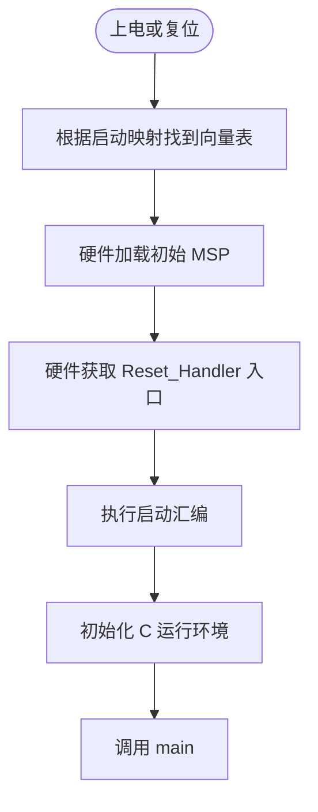

# Cortex-M4 上电启动机制

## 核心问题：CPU 如何找到 main？

CPU 不认识 `main.c`，复位后读取启动内存映射的**向量表前两项**：初始 MSP 和 Reset_Handler 入口。

在正常用户 Flash 启动模式下，`0x00000000` 的启动映射对应用户 Flash `0x08000000`。

```text
0x08000000  ┌──────────────────────┐
            │ 初始 MSP             │  ← 向量项 0
0x08000004  ├──────────────────────┤
            │ Reset_Handler 地址   │  ← 向量项 1
0x08000008  ├──────────────────────┤
            │ NMI_Handler 地址     │
0x0800000C  ├──────────────────────┤
            │ HardFault_Handler    │
            └──────────────────────┘
```

硬件行为可近似理解为：

```c
MSP = *(uint32_t *)0x08000000;
PC  = *(uint32_t *)0x08000004;
```

> 这两行仅是帮助理解的等效 C 表达式，并非 CPU 真正执行的 C 语句。

## 启动流程



## 重要概念

- **MSP**：主栈指针；硬件复位时自动加载。
- **PC**：程序计数器；从复位向量获得启动入口。
- **Reset_Handler**：复位后首个软件入口，而不是 `main()`。
- Cortex-M4 使用 Thumb；异常向量中函数入口地址最低位为 1（例如 `0x08000189`），不是从奇数字节取指。

关联：[[启动汇编与内存初始化]]、[[Reset_Handler与程序跳转]]。
