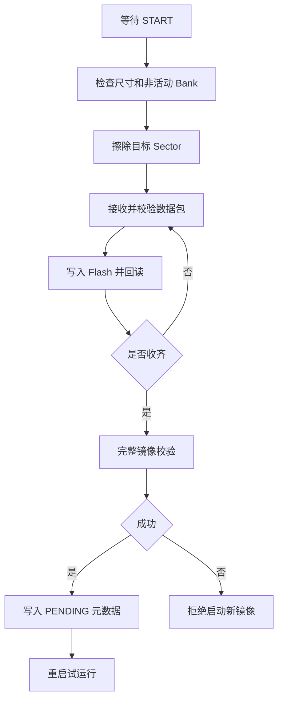

# Bootloader Flash 擦写与 UART 升级协议

## F411 Flash 的基本特点

- Flash 不能像 SRAM 一样用 `memcpy` 直接写入。
- Flash 擦除按 **Sector** 进行，编程操作有电压、对齐与宽度限制。
- Bootloader 只能写入**指定的备用应用分区**，不得擦除 Bootloader、Metadata 和已确认的镜像。

## HAL 底层入口

```c
HAL_FLASH_Unlock();
HAL_FLASHEx_Erase(&erase_cfg, &sector_error);
HAL_FLASH_Program(...);
HAL_FLASH_Lock();
```

需要检查每一步返回值、Flash 状态寄存器与回读校验；具体 `FLASH_VOLTAGE_RANGE` 以真实供电和 RM0383 为准。

## UART 升级协议建议

```text
┌────────┬─────────┬────────┬────────┬─────────┬────────┐
│ Header │ Command │ Offset │ Length │ Payload │ CRC32  │
└────────┴─────────┴────────┴────────┴─────────┴────────┘
```

- `START`：固件大小、版本、目标 Bank、完整镜像哈希/CRC。
- `DATA`：例如每包 256B，包含 offset、长度与包 CRC。
- `ACK/NACK`：回写入成功或要求重发。
- `END`：全部数据发送完成，请求整体校验。

**停等协议**：每包收到、校验、写入并回读验证之后，Bootloader 才发 ACK，ESP32 再发下一包。这样较易处理单 Bank Flash 擦写阻塞及缓冲区溢出。

## 最小 OTA 状态机



## 校验边界

- 包 CRC 检测传输错误。
- 整体 CRC/SHA-256 检测不完整/意外修改。
- **CRC 不是安全认证**；真实部署还需数字签名验证与可信更新来源。

关联：[[F411 Flash与AB分区]]、[[启动元数据与自动回滚]]。
