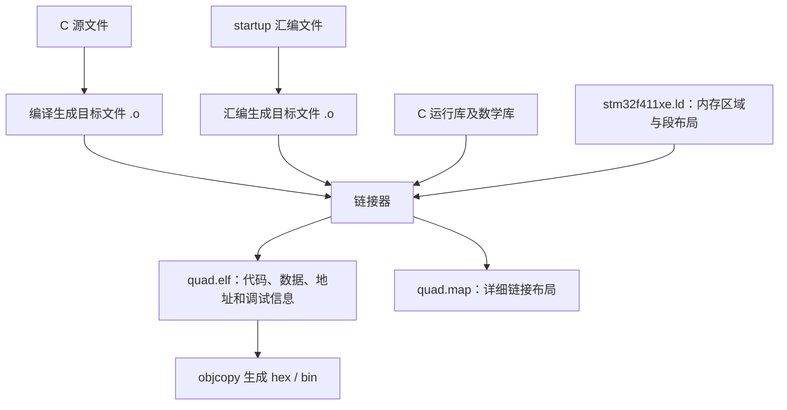

# STM32F411 链接脚本 stm32f411xe.ld 解析

本文逐段解释当前工程的 [stm32f411xe.ld](stm32f411xe.ld)，并结合 [startup_stm32f411xe.S](startup_stm32f411xe.S)、[runtime.c](runtime.c) 和 [Makefile](../Makefile) 说明其作用。

**链接脚本决定代码、常量、变量、堆和栈的地址，并向启动代码提供初始化所需的边界符号。** 它在构建固件时由链接器读取；复制变量、清零内存等运行时操作由 startup 执行。

## 1. 链接脚本在构建过程中的位置



Makefile 通过以下选项使用本文件：

```makefile
-TGCC/stm32f411xe.ld
-Wl,--gc-sections,-Map=$(TARGET).map
```

`-T` 指定链接脚本；`--gc-sections` 移除不可达的输入段；`-Map` 输出地址和段分配明细。

理解链接脚本时，还要区分：

- **输入段**：编译器或汇编器放入 `.o` 文件的内容，例如 `.text.main`、`.data.SystemCoreClock`。
- **输出段**：链接器把多个输入段合并后写入 ELF 的段，例如本脚本的 `.text`、`.data`。

本项目启用了 `-ffunction-sections -fdata-sections`，所以函数和变量经常各自拥有输入段，再由这里的通配规则收集。

## 2. ENTRY：设置 ELF 的程序入口

```ld
ENTRY(Reset_Handler)
```

它将 `Reset_Handler` 设置为 ELF 文件的入口符号，供支持 ELF 的加载、调试工具识别。

STM32 正常复位启动时，处理器从向量表读取初始 MSP 和复位入口。**仅设置 `ENTRY` 不会生成向量表，也不会自动把入口地址写入 Flash 开头。** 本工程由 startup 提供向量表，再由下文的 `.isr_vector` 规则放到 Flash 起始处。

## 3. MEMORY：声明可用的 Flash 和 RAM

```ld
MEMORY
{
    FLASH (rx)  : ORIGIN = 0x08000000, LENGTH = 512K
    RAM   (xrw) : ORIGIN = 0x20000000, LENGTH = 128K
}
```

| 区域 | 起始地址 | 容量 | 最后一个有效字节地址 |
| --- | --- | --- | --- |
| `FLASH` | `0x08000000` | 512 KiB，即 `0x80000` | `0x0807FFFF` |
| `RAM` | `0x20000000` | 128 KiB，即 `0x20000` | `0x2001FFFF` |

这里 `K` 按 1024 字节计算。`ORIGIN` 是起始地址，`LENGTH` 是区域容量；`FLASH` 和 `RAM` 是脚本自定义的区域名称，供后面的 `> FLASH`、`> RAM` 引用。

括号中的 `r`、`w`、`x` 分别表示读、写、执行属性，用于链接器的区域匹配等布局判断。它们不会配置芯片的 MPU、Flash 写保护或 RAM 执行权限。

链接器会依据这些区域检查空间是否足够，但不会探测实际芯片容量；这些数值必须与目标器件匹配。

本脚本从 `0x08000000` 开始安排独立运行的固件，没有为 bootloader 留出前置空间。

## 4. 全局符号：栈顶、栈大小和堆大小

```ld
_estack = ORIGIN(RAM) + LENGTH(RAM);
_stack_size = 4K;
_heap_size = 2K;
```

计算结果为：

```text
_estack     = 0x20000000 + 0x20000 = 0x20020000
_stack_size = 4096 = 0x1000
_heap_size  = 2048 = 0x0800
```

`_estack` 指向 RAM 尾部之后的边界，作为向低地址增长的栈的初始栈顶。它同时被 startup 写入向量表第一项，并用于 `ldr sp, =_estack`。

这些赋值定义的是**链接符号**。例如 `_heap_size = 2K` 只是定义数值 2048；真正预留堆空间的是后面的 `. += _heap_size`。

在 C 中引用地址型链接符号时，常见写法为：

```c
extern char _heap_start, _heap_end;
char *begin = &_heap_start;
char *end = &_heap_end;
```

这里使用 `&` 取得符号代表的地址。链接器并未为 `_heap_start` 额外创建一个保存地址值的 C 变量。

## 5. SECTIONS：如何读懂段布局规则

```ld
SECTIONS
{
    /* 各个输出段 */
}
```

典型规则如下：

```ld
.text :
{
    *(.text .text.*)
} > FLASH
```

| 写法 | 含义 |
| --- | --- |
| 外层 `.text` | 输出段名称 |
| `{ ... }` | 该输出段收集的内容及布局操作 |
| `*(...)` | 从所有输入文件中匹配指定的输入段 |
| `.text` | 匹配名称恰好为 `.text` 的输入段 |
| `.text.*` | 匹配 `.text.main` 等带后缀的输入段 |
| `> FLASH` | 将输出段的运行地址安排在 FLASH 区域 |
| `.` | 当前位置计数器，记录正在安排的位置 |
| `. = ALIGN(4)` | 将当前位置向上调整到 4 字节边界 |
| `. += 2048` | 将当前位置向后推进 2048 字节，在该输出段内预留空间 |

`ALIGN(4)` 返回对齐后的值，赋给 `.` 才会推进当前位置。对齐可能产生填充，所以各段不一定首尾紧接，输出段也可能因为输入段要求更严格的对齐而出现额外间隔。

不同内存区域分别分配空间：遇到 `> RAM` 时，链接器根据 RAM 的可用位置安排运行地址，并不会沿着前面 Flash 的数值地址继续排下去。

## 6. .isr_vector：把中断向量表放在 Flash 开头

```ld
.isr_vector :
{
    . = ALIGN(512);
    KEEP(*(.isr_vector))
} > FLASH
```

startup 在 `.isr_vector` 输入段中提供初始栈顶、复位入口、内核异常和外设中断入口。

这是脚本中第一个安排到 Flash 的输出段；结合 Flash 起始地址，以及 startup 自身的 `.balign 512`，当前表首位于 `0x08000000`，按 512 字节对齐。

`KEEP(...)` 要求在段垃圾回收时保留这些输入段。中断入口由硬件访问，不能单纯按普通函数调用关系判断它是否有用。当前 Makefile 启用了 `--gc-sections`，因此此处显式保留向量表很关键。

本项目向量表有 102 项，共 408 字节。**512 字节是对齐要求，408 字节是内容大小**，两者含义不同。

## 7. .text：代码和只读常量

```ld
.text :
{
    *(.text .text.*)
    *(.rodata .rodata.*)
    KEEP(*(.init))
    KEEP(*(.fini))
    . = ALIGN(4);
} > FLASH
```

这段收集：

- `.text`、`.text.*`：函数机器码，包括 startup 的复位处理和默认中断处理代码。
- `.rodata`、`.rodata.*`：只读数据，例如实际生成存储的常量表和字符串。
- `.init`、`.fini`：运行库初始化与收尾相关的代码段，使用 `KEEP` 保留。

这里把只读输入段也合并进了名为 `.text` 的输出段，所以最终 ELF 中可能没有单独的 `.rodata` 输出段。

`.init` / `.fini` 是代码段，后文的 `.init_array` / `.fini_array` 是函数指针数组。保留某个段只保证内容存在，不会让 CPU 自动执行它。

末尾的 `ALIGN(4)` 将结束位置调整到 4 字节边界。

## 8. .ARM.extab 和 .ARM.exidx：栈展开相关信息

```ld
.ARM.extab :
{
    *(.ARM.extab* .gnu.linkonce.armextab.*)
} > FLASH

.ARM.exidx :
{
    __exidx_start = .;
    *(.ARM.exidx* .gnu.linkonce.armexidx.*)
    __exidx_end = .;
} > FLASH
```

这些段保存 ARM 异常处理 ABI 使用的栈展开描述和索引，可供异常展开等运行库机制使用。纯 C 工程也可能因为链接了运行库而出现这些内容。

`__exidx_start` 和 `__exidx_end` 标记索引表的起止边界，使用范围为 `[start, end)`，不包含结束地址。

这里的“异常展开”与向量表里的 `HardFault_Handler`、外设 IRQ 入口不是同一种机制；这两段不会配置 NVIC 或中断处理函数。

## 9. 初始化和析构函数指针数组

### 9.1 .preinit_array

```ld
.preinit_array :
{
    PROVIDE_HIDDEN(__preinit_array_start = .);
    KEEP(*(.preinit_array*))
    PROVIDE_HIDDEN(__preinit_array_end = .);
} > FLASH
```

保存常规初始化数组之前执行的回调函数指针。

`PROVIDE_HIDDEN` 按需提供隐藏符号：当符号被引用且没有其他定义时，链接器提供这里的定义。隐藏是 ELF 符号可见性属性，不代表 C 代码无法通过名称引用它。

### 9.2 .init_array

```ld
.init_array :
{
    PROVIDE_HIDDEN(__init_array_start = .);
    KEEP(*(SORT(.init_array.*)))
    KEEP(*(.init_array))
    PROVIDE_HIDDEN(__init_array_end = .);
} > FLASH
```

保存 `main()` 前执行的初始化函数指针，C++ 全局对象构造函数通常通过这一机制注册。

这里的 `SORT` 按输入段名称排序，再收集没有后缀的 `.init_array`。编译器常用带优先级编码的后缀表达顺序；这条规则本身是名称排序，不是任意字符串的数值排序。

startup 在 `.data` 复制和 `.bss` 清零之后调用 `__libc_init_array()`，由运行库遍历初始化数组。**链接脚本负责收集表，运行库负责调用表中的函数。**

### 9.3 .fini_array

```ld
.fini_array :
{
    PROVIDE_HIDDEN(__fini_array_start = .);
    KEEP(*(SORT(.fini_array.*)))
    KEEP(*(.fini_array))
    PROVIDE_HIDDEN(__fini_array_end = .);
} > FLASH
```

保存程序结束时可能使用的析构回调函数指针。

当前 startup 在 `main()` 返回后直接进入死循环，没有调用 `exit()` 或 `__libc_fini_array()`。因此，即使脚本保留了 `.fini_array`，也不会因此自动执行析构流程。

## 10. .data：RAM 中运行，Flash 中保存初始值

```ld
.data :
{
    . = ALIGN(4);
    _sdata = .;
    *(.data .data.*)
    . = ALIGN(4);
    _edata = .;
} > RAM AT > FLASH
_sidata = LOADADDR(.data);
```

这是本脚本最需要理解的一段。

对于具有非零初始值、需要实际存储的可写全局或静态变量，例如：

```c
int limit = 100;
```

初始值需要随固件保存到非易失的 Flash 中，程序运行时又需要在 RAM 中读写。为此，链接器安排两个地址：

| 概念 | 含义 | 本段的配置 |
| --- | --- | --- |
| VMA，运行地址 | 程序执行时访问该段的地址 | `> RAM` |
| LMA，加载地址 | 固件保存该段初始内容的位置 | `AT > FLASH` |

`AT > FLASH` 会在 Flash 区域安排 `.data` 的初始内容，`LOADADDR(.data)` 取得这部分内容的加载地址。

| 链接符号 | startup 中的用途 |
| --- | --- |
| `_sidata` | 从这里读取 Flash 中的初始值 |
| `_sdata` | 从这里开始写入 RAM |
| `_edata` | RAM 复制终点，不包含该地址 |

```text
Flash 中的 .data 初始内容
[_sidata, _sidata + (_edata - _sdata))
                   │
                   │ startup 每次复制 4 字节
                   ▼
RAM 中的 .data 运行内容
[_sdata, _edata)
```

**`AT > FLASH` 只安排加载位置，不会生成内存复制指令。** startup 必须使用这些符号完成复制。段的起止都按 4 字节对齐，与当前启动循环的处理粒度配合。

`.data` 因而同时占用 Flash 初始镜像空间和 RAM 运行空间。

## 11. .bss：只预留 RAM，由 startup 清零

```ld
.bss (NOLOAD) :
{
    . = ALIGN(4);
    _sbss = .;
    *(.bss .bss.*)
    *(COMMON)
    . = ALIGN(4);
    _ebss = .;
} > RAM
```

`.bss` 通常容纳未显式初始化、或初始化为零的全局和静态变量：

```c
int received_count;
static int ready = 0;
```

`NOLOAD` 表示该输出段不需要随镜像提供可加载的初始数据字节，但仍占用运行时地址空间。对于当前 ELF，`.bss` 有内存大小，没有对应的初始内容载荷。

零值由 startup 在复位时写入 `[_sbss, _ebss)`。**`NOLOAD` 本身不会清零内存**；它也不等同于“不占 RAM”。

`COMMON` 用来接收以 common 形式产生的暂定全局定义。在某些编译选项下，这些定义已经进入 `.bss`，但保留该规则仍可接收其他目标文件中的 common 符号。

## 12. .noinit：留出 startup 不初始化的 RAM

```ld
.noinit (NOLOAD) :
{
    . = ALIGN(8);
    *(.noinit .noinit.*)
} > RAM
```

它收集显式放入 `.noinit` 的对象。当前 startup 只初始化 `.data` 和 `.bss`，不会处理该段。

例如，可以把无需 startup 初始化的缓冲区放在这里：

```c
__attribute__((section(".noinit")))
unsigned char retained_buffer[64];
```

该段中的数据在使用前需要由应用判断是否有效。它能否跨复位保留还取决于供电、复位方式、加载工具及其他代码；它不具备掉电存储能力。

这里 `NOLOAD` 决定没有镜像初始载荷，startup 的处理范围决定复位代码不清理它，两者共同形成当前行为。

## 13. .heap：固定预留 2 KiB 堆

```ld
.heap (NOLOAD) :
{
    . = ALIGN(8);
    _end = .;
    end = .;
    _heap_start = .;
    . += _heap_size;
    _heap_end = .;
} > RAM
```

这段先将位置对齐到 8 字节，然后记录堆起始地址，推进 2048 字节，再记录堆结束地址。

`_end`、`end` 和 `_heap_start` 在这里是同一个地址的不同符号名。实际分配范围由 `[_heap_start, _heap_end)` 表示。

[runtime.c](runtime.c) 的 `_sbrk()` 使用这两个边界，为 C 运行库申请和回收堆地址空间；超出范围时设置 `errno = ENOMEM` 并返回 `(void *)-1`。`malloc()` 等分配器通常通过该接口获取底层空间，具体可分配给用户的容量还要扣除管理开销等。

**堆和栈之间即使还有大量空闲 RAM，当前 `_sbrk()` 也只允许使用这 2 KiB。** 增加可用堆空间需要调整 `_heap_size`，而不是仅看 RAM 总剩余量。

此处预留的是地址范围，不会在启动时调用 `malloc()`，也不会自动把堆内容清零。

## 14. .stack：固定放在 RAM 顶部的 4 KiB

```ld
.stack _estack - _stack_size (NOLOAD) :
{
    _stack_limit = .;
    . += _stack_size;
} > RAM
```

这段显式指定了起始地址：

```text
_stack_limit = _estack - _stack_size
             = 0x20020000 - 0x1000
             = 0x2001F000

预留范围：  [0x2001F000, 0x20020000)
初始 SP：   0x20020000
增长方向：  向低地址增长
```

它不会紧贴前面的 `.heap` 放置，而是固定在 RAM 顶部。堆结束与栈下界之间可以留有空闲间隔。

这里 `. += _stack_size` 是链接器按地址从低到高预留空间，与运行时 CPU 栈向低地址增长不矛盾。

startup 负责把 SP 设置为 `_estack`。`_stack_limit` 仅是地址符号，本脚本和当前 startup 没有把它配置成硬件边界保护，因此栈超出预留范围时不会因为这个符号而自动停止。

## 15. ASSERT：在链接时检查堆栈是否重叠

```ld
ASSERT(_heap_end <= _stack_limit,
       "SRAM overflow: heap overlaps stack")
```

若静态数据、`.noinit` 和预留堆不断增大，导致堆结束超过栈下界，链接就会失败，并给出这条错误信息。

`<=` 允许两者恰好相接；所有范围均以结束地址不包含在内来理解。

这个断言与 `MEMORY` 区域容量检查一起约束链接布局。它检查的是构建时已经确定的地址，无法检测运行时递归、局部大数组或中断嵌套造成的实际栈溢出。

## 16. /DISCARD/：丢弃 GNU-stack 元信息

```ld
/DISCARD/ : { *(.note.GNU-stack) }
```

它将输入文件中的 `.note.GNU-stack` 段丢弃。这类内容属于工具链使用的栈执行属性元信息，不是需要放到 STM32 Flash 中执行的业务代码。

丢弃它不会配置芯片的实际栈权限，也不代表将整个 `.stack` 段删除。`.note.GNU-stack` 与前文预留 RAM 的 `.stack` 是两个不同的段。

## 17. 用本工程已有 ELF 和 map 看实际布局

下表来自撰写文档时目录中已有的 [quad.elf](../build/quad.elf) 和 [quad.map](../build/quad.map)，**用于展示这次构建产物的布局，未重新构建**。代码、编译器或选项变化后，具体地址可能变化。

| 输出段 | 运行地址 VMA | 初始内容的 Flash 地址 | 大小 | 启动时如何处理 |
| --- | --- | --- | --- | --- |
| `.isr_vector` | `0x08000000` | `0x08000000` | 408 B | 硬件读取入口 |
| `.text` | `0x080001C0` | `0x080001C0` | 52,984 B | 在 Flash 中执行或读取 |
| `.ARM.exidx` | `0x0800D0B8` | `0x0800D0B8` | 8 B | 供运行库按需读取 |
| `.data` | `0x20000000` | `0x0800D0C0` | 476 B | 从 Flash 复制到 RAM |
| `.bss` | `0x200001E0` | 无初始内容载荷 | 2,456 B | 写零 |
| `.noinit` | `0x20000B78` | 无初始内容载荷 | 0 B | startup 不处理 |
| `.heap` | `0x20000B78` | 无初始内容载荷 | 2,048 B | `_sbrk()` 按需使用 |
| `.stack` | `0x2001F000` | 无初始内容载荷 | 4,096 B | CPU 使用 SP 访问 |

本次 `.ARM.extab` 和三个初始化/析构数组没有实际内容，表中未列出。

对应的关键符号为：

```text
_sidata      = 0x0800D0C0
_sdata       = 0x20000000
_edata       = 0x200001DC
_sbss        = 0x200001E0
_ebss        = 0x20000B78
_heap_start  = 0x20000B78
_heap_end    = 0x20001378
_stack_limit = 0x2001F000
_estack      = 0x20020000
```

注意 `.data` 在 `0x200001DC` 结束，而 `.bss` 从 `0x200001E0` 开始，中间有 4 字节间隔。输入段自身也有对齐要求，因此脚本写了 `ALIGN(4)` 不代表段一定只要求 4 字节对齐。

```text
Flash
0x08000000  向量表
            对齐间隔
0x080001C0  代码与只读常量
0x0800D0B8  ARM 展开索引
0x0800D0C0  .data 初始镜像 ──────────────┐
                                       │ 复位时复制
RAM                                    ▼
0x20000000  .data
0x200001DC  .data 结束
            对齐间隔
0x200001E0  .bss
0x20000B78  .bss 结束、堆起点（本次 .noinit 为空）
0x20001378  堆结束
            空闲间隔
0x2001F000  预留栈下界
            栈使用时向低地址增长 ↑
0x20020000  初始栈顶、RAM 末尾边界
```

### 17.1 如何自己查看

在 `software` 目录执行以下只读命令：

```bash
arm-none-eabi-objdump -h build/quad.elf
arm-none-eabi-readelf -S build/quad.elf
arm-none-eabi-readelf -l build/quad.elf
arm-none-eabi-nm -n build/quad.elf
arm-none-eabi-size build/quad.elf
```

`objdump -h` 同时展示 VMA、LMA 和段大小，是理解 `.data` 双地址最直接的入口。`readelf -l` 展示 ELF 加载段，`FileSiz` 与 `MemSiz` 有助于区分文件载荷与内存占用。

对于 `NOLOAD` 段，工具可能仍显示某个 LMA 数值；应结合内容标志和文件载荷判断，不能据此认为 Flash 中存在对应大小的初始数据。

### 17.2 为什么 ELF 很大，烧录镜像却小得多

脚本没有逐一列出 `.debug_info`、`.debug_line` 等段。链接器可以将未显式匹配的输入段作为孤儿段安排到输出中，调试信息也会保存在 ELF 内，供调试工具使用。

已有 ELF 中的 `.debug_*` 没有运行时分配和加载属性，不占 STM32 的 Flash/RAM；它们会增加磁盘上的 ELF 文件大小。`objcopy` 生成的烧录镜像主要包含需要加载的内容。

同理，自定义段名不会因为没有出现在脚本中就一定被丢弃。如果新增 `.RamFunc` 或其他特殊段，应同时检查输出位置，以及 startup 是否提供所需的复制和初始化逻辑。

### 17.3 size 输出中的 bss 为何比 .bss 段大

本次工具输出为：

```text
text    data    bss
53400   476     8600
```

这里是按类别汇总：`text` 包含只读内容，并非只统计名为 `.text` 的输出段；`bss` 也包含本项目没有初始文件载荷的预留堆和栈。

本次 `8600 = 2456（.bss）+ 2048（.heap）+ 4096（.stack）`。需要分析具体段时，应查看 `objdump -h` 和 map，不能将汇总列名直接当作同名输出段的大小。
