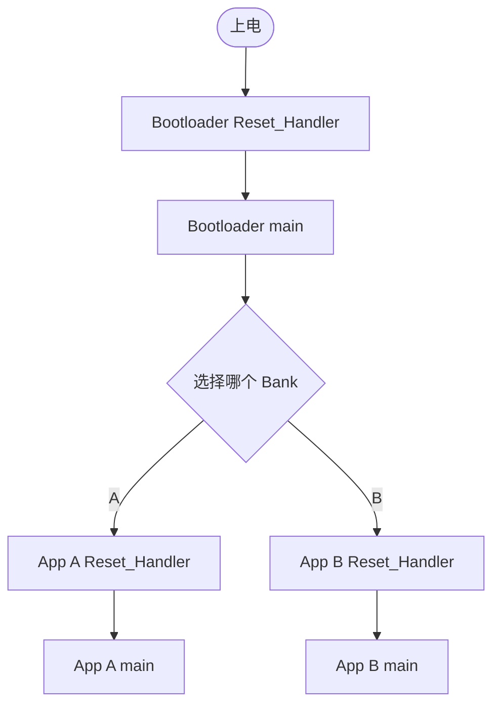

# Reset_Handler 与 Bootloader 跳转 App

## Reset_Handler 在什么时候执行？

- **真正的硬件/系统复位**：上电、NRST、`NVIC_SystemReset()`、IWDG 触发后，执行启动映射对应程序的 Reset_Handler。
- **软件切换 App**：Bootloader 手动设置环境并跳到目标 App 的 Reset_Handler；此时**没有发生硬件复位**。
- 普通外设中断、FreeRTOS 任务切换：**不会**执行 Reset_Handler。

## 为什么不能只改 VTOR？

`SCB->VTOR` 只改变异常入口表的位置，不会自动改变 PC、MSP、时钟、外围设备配置或 `.data/.bss`。

## App 向量表前两个字

```c
uint32_t app_msp = *(volatile uint32_t *)app_addr;
uint32_t app_reset = *(volatile uint32_t *)(app_addr + 4U);
```

- `app_msp`：必须是合理、对齐且位于 SRAM 的栈顶。
- `app_reset`：必须是当前 App Flash 范围内的合法 Thumb 入口（最低位为 1）。
- 以上检查**不足以证明固件完整或可信**；还要校验完整固件、有效状态、必要时签名。

## 软件跳转的正确步骤（设计级伪代码）

```text
确认目标 App 有效
  ↓
电机输出安全、关闭 Bootloader 使用的外设与 DMA
  ↓
屏蔽可屏蔽中断、停止 SysTick、清理挂起状态
  ↓
切换到预期的特权线程模式和 MSP
  ↓
SCB->VTOR = 目标 App 地址；DSB/ISB
  ↓
装载 App 初始 MSP、处理 PRIMASK
  ↓
跳转 App Reset_Handler
  ↓
App 启动汇编重新初始化 .data/.bss，调用 main
```

> [!warning] 实现提醒
> 切换 MSP 以后不能继续依赖 Bootloader 原来的栈帧。完整跳转函数需针对 GCC、HAL、启动状态和中断状态设计；不要直接从 FreeRTOS 任务或 ISR 照搬裸机跳转示例。

## A/B 使用场景



关联：[[Cortex-M4上电启动]]、[[启动元数据与自动回滚]]。
