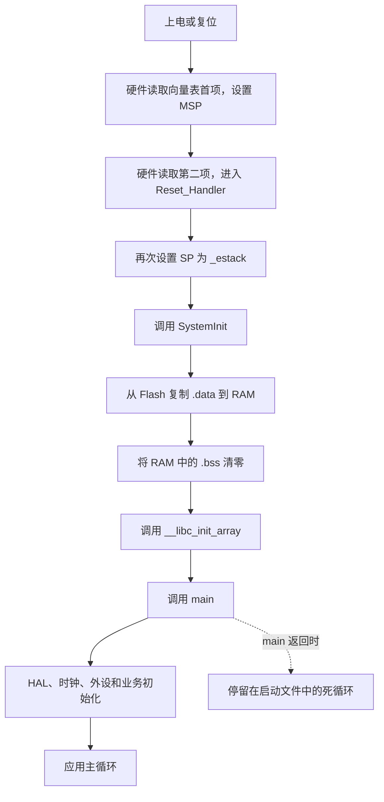

# STM32F411 startup 启动文件讲解

本文以当前工程实际参与 GCC 构建的 [startup_stm32f411xe.S](startup_stm32f411xe.S.md) 为主，结合 [链接脚本](stm32f411xe.ld)、[runtime.c](runtime.c)、[SystemInit()](../Core/Src/system_stm32f4xx.c) 和 [main()](../Core/Src/main.c)，解释芯片从复位到运行应用程序的过程。

startup 的核心职责是：**提供复位和中断入口，建立栈与 C/C++ 运行所需的初始环境，然后调用 `main()`。**

## 1. 先看完整启动流程

以下按本工程从主 Flash 正常复位启动的情况说明。链接脚本将固件放在 `0x08000000`，没有为 bootloader 预留偏移。



这里有三种不同的工作：复位最初的取向量操作由处理器硬件完成；内存和运行库初始化由启动代码完成；电机、传感器等应用初始化在 `main()` 中完成。

## 2. 文件开头：告诉汇编器目标平台

```asm
.syntax unified
.cpu cortex-m4
.fpu fpv4-sp-d16
.thumb
```

| 指令                 | 作用                            |
| ------------------ | ----------------------------- |
| `.syntax unified`  | 使用统一汇编语法                      |
| `.cpu cortex-m4`   | 指定 Cortex-M4 指令集目标            |
| `.fpu fpv4-sp-d16` | 指定单精度浮点单元对应的指令集               |
| `.thumb`           | 生成 Thumb 指令，符合 Cortex-M 的执行方式 |

这些都是**汇编指示**，用于生成目标文件，本身不会成为 CPU 执行的初始化指令。例如，`.fpu` 不会打开硬件 FPU；运行时的访问权限由 `SystemInit()` 设置。

## 3. 中断向量表：复位和中断该去哪里

对应启动文件第 11～119 行。

### 3.1 向量表的布局

```asm
.section .isr_vector,"a",%progbits
.balign 512
.global g_pfnVectors
.type g_pfnVectors, %object
g_pfnVectors:
    .word _estack
    .word Reset_Handler
    .word NMI_Handler
    .word HardFault_Handler
    ...
```

`.isr_vector` 是段名，`"a"` 表示该段需要分配到运行时地址空间，`%progbits` 表示段内有实际内容；`g_pfnVectors` 是向量表的全局符号名。每条 `.word` 放入一个 32 位值，占 4 字节。

开头两项有特殊意义：

| 相对表首的偏移  | 本工程 Flash 地址   | 内容                  | 用途                    |
| -------- | -------------- | ------------------- | --------------------- |
| `0x00`   | `0x08000000`   | `_estack`           | 复位时硬件加载到主栈指针 MSP 的初始值 |
| `0x04`   | `0x08000004`   | `Reset_Handler`     | 复位时硬件读取的执行入口          |
| `0x08`   | `0x08000008`   | `NMI_Handler`       | 不可屏蔽中断入口              |
| `0x0C`   | `0x0800000C`   | `HardFault_Handler` | HardFault 异常入口        |
| `0x3C`   | `0x0800003C`   | `SysTick_Handler`   | 系统滴答异常入口              |
| `0x40` 起 | `0x08000040` 起 | 外设中断处理函数            | 按芯片规定的 IRQ 顺序排列       |

从主 Flash 启动时，启动映射使处理器能够从启动地址读取这些表项。因此，`main()` 并不是硬件复位后直接进入的第一个函数。

函数入口在向量表中携带 Thumb 状态位，数值最低位为 1；调试时看到入口值为奇数是正常现象。

### 3.2 为什么表中有很多 `.word 0`

这些是芯片向量布局规定的保留位置，必须保留，不能为了精简而删除。

对于外设中断，表项位置为：

```text
向量表索引 = 16 + IRQn
表项地址   = 向量表基址 + 4 × (16 + IRQn)
```

例如，芯片头文件定义 `USART1_IRQn = 37`，其表项索引为 53，在本工程中地址为 `0x080000D4`。如果删掉前面的保留项，后续中断就会跳到错误的处理函数。

向量表里的 `0` 与后文的 `Default_Handler` 不同：保留项没有提供有效函数入口。

### 3.3 为什么按 512 字节对齐

本文件包含 16 个内核表项和 86 个外设位置，共 102 项，占 `102 × 4 = 408` 字节。

`.balign 512` 为这张表提供 512 字节边界对齐，满足该向量表布局的对齐要求。链接脚本也使用 `ALIGN(512)`，并将它作为 Flash 中的第一个输出段：

```ld
.isr_vector :
{
    . = ALIGN(512);
    KEEP(*(.isr_vector))
} > FLASH
```

`KEEP` 很关键：当前构建启用了 `--gc-sections`，它确保链接器不会因为缺少普通代码引用而移除向量表。

向量表只提供入口地址。外设中断能否触发，还取决于外设配置、NVIC 使能和优先级等设置。

## 4. Reset_Handler：进入 main 之前的准备

对应启动文件第 121～152 行，实际执行顺序如下。

### 4.1 设置栈指针

```asm
ldr sp, =_estack
```

链接脚本定义：

```ld
RAM (xrw) : ORIGIN = 0x20000000, LENGTH = 128K
_estack = ORIGIN(RAM) + LENGTH(RAM);
_stack_size = 4K;
```

因此：

```text
RAM 范围：      0x20000000 ～ 0x2001FFFF
初始栈顶：      0x20020000
预留栈范围：    0x2001F000 ～ 0x2001FFFF
栈增长方向：    向低地址增长
```

初始 SP 指向 RAM 末尾之后的边界是正常的，压栈时会先向下移动再使用内存。

正常复位时，硬件已从向量表设置 MSP；这里又显式设置一次。在该启动上下文中，`sp` 使用主栈，供后续 C 函数保存寄存器、返回地址及局部数据。

4 KiB 是链接时的栈空间预留量，这条指令不会配置硬件栈边界保护。

### 4.2 调用 SystemInit()

```asm
bl SystemInit
```

`bl` 是带返回地址的函数调用。实际函数位于 [system_stm32f4xx.c](../Core/Src/system_stm32f4xx.c)。

结合当前源码和 Makefile，它主要打开 FPU 的 CP10、CP11 访问权限，使后续浮点指令可以执行。当前构建使用 `-mfpu=fpv4-sp-d16 -mfloat-abi=hard`。

该函数还包含两个条件编译分支：外部 SRAM/SDRAM 初始化，以及通过 `SCB->VTOR` 指定向量表地址。当前源码中的相关配置未启用，Makefile 也没有定义 `USER_VECT_TAB_ADDRESS`，所以当前配置不会在这里主动重定位向量表。

**本工程配置 PLL 和系统工作时钟的函数是 `main()` 中的 `SystemClock_Config()`。** 阅读其他模板时，不应把模板注释中的“系统初始化”直接理解为本项目已完成全部时钟设置。

还有一个顺序上的要点：此时 `.data` 尚未复制，`.bss` 尚未清零。若扩展 `SystemInit()`，不能依赖普通全局变量或静态变量已经拥有 C 语言规定的初始值。访问外设寄存器不依赖这些变量的初始化。

### 4.3 把 .data 初始值从 Flash 复制到 RAM

```asm
ldr r0, =_sidata
ldr r1, =_sdata
ldr r2, =_edata
1:
    cmp r1, r2
    bcs 2f
    ldr r3, [r0], #4
    str r3, [r1], #4
    b 1b
```

例如，文件作用域中定义了可写变量：

```c
int speed_limit = 100;
```

它在运行时需要位于 RAM 中，以便修改；初始值 `100` 则必须随固件保存在 Flash 中。链接脚本通过下面的布局同时描述这两个位置：

```ld
.data :
{
    . = ALIGN(4);
    _sdata = .;
    *(.data .data.*)
    . = ALIGN(4);
    _edata = .;
} > RAM AT > FLASH
_sidata = LOADADDR(.data);
```

| 符号 | 含义 |
| --- | --- |
| `_sidata` | Flash 中 `.data` 初始值的起始地址，即加载地址 |
| `_sdata` | RAM 中 `.data` 的起始地址，即运行地址 |
| `_edata` | RAM 中 `.data` 的结束地址，不包含此地址 |

循环每次复制 4 字节，直到目标指针达到结束地址。对应的逻辑可以写成：

```c
/* 仅用于说明汇编逻辑。 */
uint32_t *src = &_sidata;
uint32_t *dst = &_sdata;
while (dst < &_edata) {
    *dst++ = *src++;
}
```

`ldr r0, =_sidata` 是把符号所表示的地址加载到寄存器；`ldr r3, [r0], #4` 才是读取该地址中的数据，并让地址增加 4。链接器符号本身不需要像普通 C 变量一样占用存储空间。

### 4.4 将 .bss 清零

```asm
2:
    ldr r1, =_sbss
    ldr r2, =_ebss
    movs r3, #0
3:
    cmp r1, r2
    bcs 4f
    str r3, [r1], #4
    b 3b
```

`.bss` 通常容纳未显式初始化、或初始化为零的全局变量和静态变量，例如：

```c
int packet_count;
static int ready = 0;
```

C 语言要求这些具有静态存储期的对象在程序开始时为零，因此启动代码逐字清零 `[_sbss, _ebss)`。

链接脚本将 `.bss` 标记为 `NOLOAD`，无需在 Flash 中保存一整段零。`.data` 和 `.bss` 的边界均做了 4 字节对齐，与这里每次处理 4 字节的循环配合。

这一步只清理 `.bss`，**不会清空整个 RAM**。栈上的普通自动局部变量也不会因此自动获得零值。

脚本中的 `.noinit` 不在清零范围内；startup 不会修改它。它在某次复位后能否保留原值，还取决于供电、复位类型和其他代码，不能把它当成掉电存储。

### 4.5 初始化运行库和静态构造函数

```asm
4:
    bl __libc_init_array
```

`__libc_init_array()` 由链接的 C 运行库提供，用于在 `main()` 前执行初始化回调，包括 `.preinit_array`、`.init_array` 中的函数；使用 C++ 时，全局对象的构造函数通常也由该机制调用。

链接脚本保留了这些数组和对应的边界符号；[runtime.c](runtime.c) 则提供空的 `_init()` 和 `_fini()` 钩子。

该调用位于内存初始化之后，因此构造函数可以使用已初始化的全局变量。纯 C 工程也可以保留此启动步骤，不代表本项目一定存在 C++ 对象。

### 4.6 调用 main()，并处理其返回情况

```asm
    bl main
5:
    b 5b
```

此时，普通 C 程序所需的栈、`.data` 和 `.bss` 已准备好，运行库初始化回调也已执行。

当前 [main.c](../Core/Src/main.c) 的初始化顺序为：

```text
HAL_Init()
→ SystemClock_Config()
→ MX_GPIO_Init()
→ MX_ADC1_Init()
→ MotorApp_Init()
→ SensorApp_Init()
→ MotorApp_StartWatchdog()
→ while (1)：SensorApp_Poll()、MotorApp_Poll()
```

如果 `main()` 意外返回，CPU 会进入 `5: b 5b` 的无限循环。这里没有操作系统可返回，也没有调用 `exit()` 或执行 `.fini_array` 析构流程。

### 4.7 循环中的数字和跳转后缀

| 写法 | 含义 |
| --- | --- |
| `1:`、`2:` 等 | 汇编局部数字标签 |
| `1b` | 向后寻找最近的 `1:`，`b` 表示 backward |
| `2f` | 向前寻找最近的 `2:`，`f` 表示 forward |
| `cmp r1, r2` | 比较目标指针与结束地址 |
| `bcs` | 在这里表示无符号“大于或等于”时跳转，结束循环 |

## 5. 默认中断处理：未实现的入口会去哪里

对应启动文件第 154 行之后。

```asm
Default_Handler:
    b Default_Handler

.macro weak_handler name
    .weak \name
    .thumb_set \name, Default_Handler
.endm

weak_handler SysTick_Handler
weak_handler USART1_IRQHandler
...
```

`Default_Handler` 是一个无限循环。宏为每个处理函数建立一个指向它的弱符号别名：

- `.weak` 允许其他目标文件中的同名强符号覆盖该默认定义。
- `.thumb_set` 将处理函数名关联到 `Default_Handler`，并保留 Thumb 函数属性。
- 若项目没有提供对应实现，触发该中断后就会进入默认循环。

因此，添加处理函数时通常无需修改 startup，只需在参与链接的 C 文件中提供名称完全一致、非 `static` 的函数。例如本工程已经定义了：

| 处理函数 | 实现文件 | 当前职责 |
| --- | --- | --- |
| `SysTick_Handler` | [stm32f4xx_it.c](../Core/Src/stm32f4xx_it.c) | 调用 `HAL_IncTick()`，维护 HAL 时间基准 |
| `USART1_IRQHandler` | [stm32f4xx_it.c](../Core/Src/stm32f4xx_it.c) | 调用 `SensorApp_GpsIRQ()` |
| `USART2_IRQHandler` | [stm32f4xx_it.c](../Core/Src/stm32f4xx_it.c) | 调用 `SensorApp_LinkIRQ()` |
| `TIM3_IRQHandler` | [motor_app.c](../Core/Src/motor_app.c) | 处理定时器更新，更新电机 PWM 比较值并检查控制循环超时 |

如果处理函数使用 C++ 实现，还需通过 `extern "C"` 保持符号名，才能覆盖启动文件中的入口。

`Reset_Handler` 和 `Default_Handler` 在这份 GCC 文件中使用 `.global` 定义；批量建立弱别名的是后面的异常和 IRQ 处理函数。

## 6. startup、链接脚本、runtime.c 如何配合

| 文件 | 提供的内容 |
| --- | --- |
| `startup_stm32f411xe.S` | 向量表、复位流程、内存复制与清零、默认处理函数 |
| `stm32f411xe.ld` | Flash/RAM 布局、各段位置、栈顶和初始化边界符号 |
| `runtime.c` | `_init` / `_fini` 钩子，以及供运行库分配堆内存的 `_sbrk()` |
| `system_stm32f4xx.c` | 早期系统初始化函数 `SystemInit()` |
| `main.c` 及其他应用文件 | HAL、工作时钟、外设、业务逻辑和实际中断处理 |

链接脚本中的 `ENTRY(Reset_Handler)` 设置 ELF 入口元信息。芯片正常复位时，真正决定执行入口的是向量表第二项；两者在本工程中指向同一个函数。

RAM 的布局可概括为：

```text
低地址 0x20000000
    .data       从 Flash 复制初始值
    .bss        由 startup 清零
    .noinit     startup 不处理
    .heap       链接脚本预留 2 KiB，runtime.c 的 _sbrk 使用
    空闲间隔
    .stack      链接脚本预留 4 KiB，运行时向低地址增长
高地址 0x20020000 = _estack
```

链接脚本用 `ASSERT(_heap_end <= _stack_limit, ...)` 检查预留堆是否与预留栈重叠。这个检查发生在链接时，不会检测程序运行期间的栈溢出。

## 7. 其余汇编声明的作用

| 写法 | 作用 |
| --- | --- |
| `.section .text.Reset_Handler,"ax",%progbits` | 将复位代码放到可分配、可执行的代码段中 |
| `.global` | 让符号能被其他目标文件和链接器引用 |
| `.type ..., %function` / `%object` | 标明符号是函数还是数据对象 |
| `.thumb_func` | 将紧随其后的函数入口标记为 Thumb 函数 |
| `.size Reset_Handler, .-Reset_Handler` | 用当前位置减起始地址，记录符号大小，便于链接和调试工具识别 |
| `.section .note.GNU-stack,"",%progbits` | 提供栈执行属性相关的工具链元信息；本项目链接脚本将其丢弃 |

## 8. 为什么工程里还有其他 startup 文件

[Makefile](../Makefile) 明确编译的是 `GCC/startup_stm32f411xe.S`，使用 `-nostartfiles` 避免工具链自动加入默认启动文件，并通过 `-TGCC/stm32f411xe.ld` 指定本项目的链接脚本。

[EWARM/startup_stm32f411xe.s](../EWARM/startup_stm32f411xe.s) 属于 IAR 工具链：它提供相同芯片的向量顺序，在 `Reset_Handler` 中调用 `SystemInit()`，然后跳入 `__iar_program_start`，由 IAR 运行库继续完成内存和运行环境初始化。

`Drivers/CMSIS` 下还保存有厂商为不同工具链提供的模板。它们不会因为存在于目录中就自动参与当前 GCC 构建。分析本项目的执行顺序，应以 Makefile 选中的启动文件为准。
