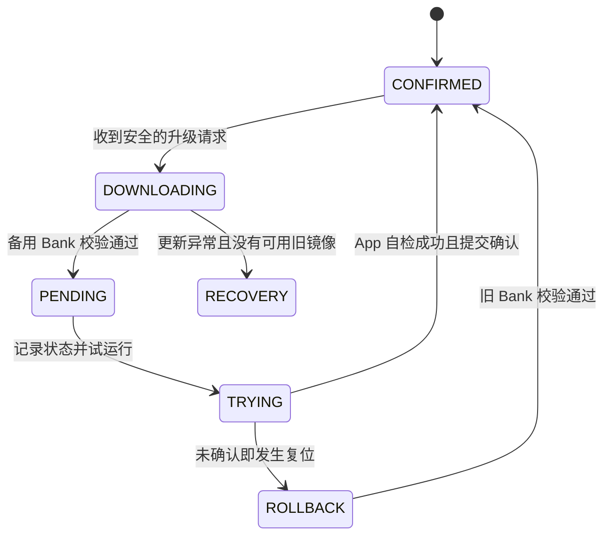

# Boot Metadata、试运行与自动回滚

## 为什么需要 Metadata？

Bootloader 需要在重启后仍知道：哪个 Bank 已确认正常、哪个 Bank 是新固件，以及新固件是否试运行成功。

## 核心状态

| 状态 | 含义 |
|---|---|
| `CONFIRMED` | 已确认可用的正式版本 |
| `PENDING` | 已写入并通过校验，待首次试运行 |
| `TRYING` | 新 App 已被尝试启动，尚未确认 |
| `RECOVERY` | 无可信可启动镜像或需重新升级 |

建议至少保存：`magic`、`sequence`、`confirmed_bank`、`pending_bank`、状态、两个镜像的长度及 CRC、元数据自身 CRC。

## 升级时序

## 掉电安全的元数据双副本

- Sector 2：Metadata 0。
- Sector 3：Metadata 1。
- 更新时先把更高 `sequence` 的完整记录写入另一 Sector，**读回验证成功后**才考虑擦除旧记录。
- 启动时选择 CRC 正确、序列号最新且字段合法的记录。
- 两份都无效：进入安全恢复，不随意启动未知固件。

## 自动回滚

- Bank A 已确认 → B 更新完标记 `PENDING`。
- 首次试运行 B 前提交 `TRYING`。
- B 自检成功后提交 `CONFIRMED(B)`。
- 如果 B 崩溃/看门狗复位、未确认，Bootloader 回退到仍有效的 A。

> [!warning] 看门狗与安全确认
> 看门狗可帮助卡死的新程序恢复执行，但必须设计看门狗启动与喂狗策略。飞控仅在电机禁用且关键外设自检通过后才确认新版本。

关联：[[Flash擦写与UART升级协议]]、[[Reset_Handler与程序跳转]]。
