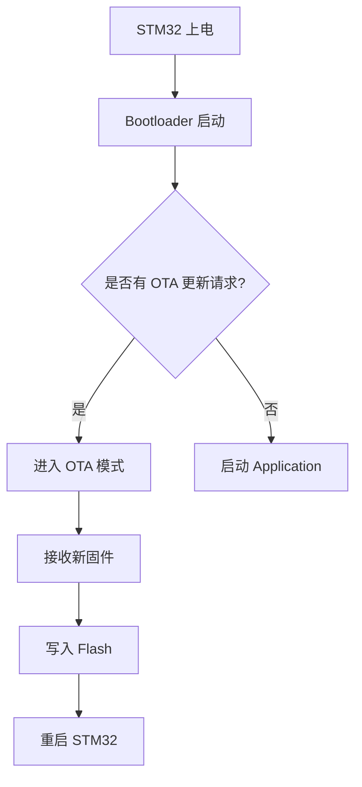

```text
低地址                              高地址
┌────────────┬────────────────────────────────┐
   bootloader               APP1.0
└────────────┴────────────────────────────────┘
```


```text
低地址                              高地址
┌────────────┬────────────────────────────────┐
   bootloader               APP2.0
└────────────┴────────────────────────────────┘
```



