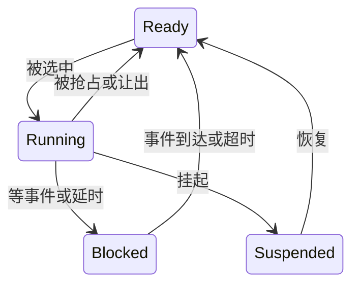
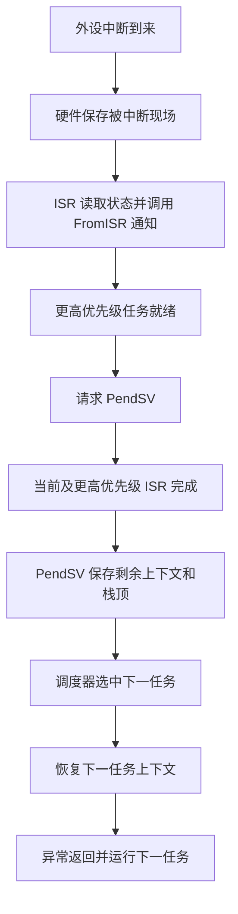

# Day 3：FreeRTOS 调度与上下文

[[02-Day2-内存布局与外设总线|上一天]] · [[00-开始这里|总计划]] · [[04-Day4-FreeRTOS同步与中断|下一天]]

本页调度先假设**单核、原生 FreeRTOS、固定优先级、无特殊调度扩展**。上下文部分假设 Cortex-M3/M4 常见移植。

## 今日任务（240 分钟）

- [ ] 90 分钟：理解六个问题。
- [ ] 60 分钟：根据就绪/阻塞状态画调度时间线。
- [ ] 45 分钟：列出一个传感器任务的栈预算，画寄存器保存路径。
- [ ] 45 分钟：复习 Day 2、自测并口述切换过程。

## Q16 调度规则与任务状态

调度器从当前**就绪任务中选择最高优先级的任务**。FreeRTOS 任务优先级数值越大，优先级越高；不要与 Cortex-M 的 NVIC 中断优先级数值方向混淆。

| 状态 | 含义 | 何时离开 |
|---|---|---|
| Running | 正在 CPU 上运行 | 阻塞、挂起、被抢占、同级切换等 |
| Ready | 可以运行，正在等 CPU | 被调度选中 |
| Blocked | 等队列、通知、信号量、延时等 | 事件到达或超时 |
| Suspended | 显式挂起等 | 按 API 规则恢复；普通等待超时不会让显式挂起任务恢复 |

内部实现中，某些无限期等待可能借用挂起链表；不要把内部链表位置和上表的概念状态完全等同。



高优先级任务调用带阻塞时间的接收函数，队列为空时进入 Blocked，低优先级任务才有机会运行。高优先级任务用 `while (!event) {}` 忙等则一直就绪，会压住低优先级任务。

“高优先级就能每 1ms 准时运行”不成立：中断屏蔽、临界区、其他更高优先级工作、驱动等待都可能造成延迟。实时性需要分析最坏情况响应时间，而不是只选一个大优先级数字。

## Q17 抢占与时间片

```c
/* 原生 FreeRTOSConfig.h 示例 */
#define configUSE_PREEMPTION   1
#define configUSE_TIME_SLICING 1
```

| 设置 | 意义 |
|---|---|
| PREEMPTION=1 | 更高优先级任务变为就绪时，可在允许调度的时机抢占当前任务 |
| TIME_SLICING=1 | 在常规抢占调度下，tick 可触发同优先级就绪任务轮转 |
| TIME_SLICING=0 | 不因单纯 tick 到来而要求同级轮转；仍可能因阻塞、yield 等切换 |
| PREEMPTION=0 | 协作式调度，主要靠任务阻塞/让出等产生切换；ISR 显式请求切换等仍需看移植与调用路径 |

时间片主要解决同优先级轮转；优先级抢占解决不同优先级竞争。它不是所有任务平分 CPU，也不保证每个同级任务获得完全相同的实际运行时间。[FreeRTOS 调度说明](https://www.freertos.org/Documentation/02-Kernel/02-Kernel-features/01-Tasks-and-co-routines/04-Task-scheduling)

### 时间线推演

A、B 优先级都为 2，始终就绪；C 优先级为 3，起初阻塞。开启抢占和时间片，tick 每 1ms；为简化，忽略切换开销：

```text
0～1ms：A
1～2ms：B
2～2.3ms：A
2.3ms：ISR 给 C 等待的通知，并请求退出 ISR 后调度
2.3～2.6ms：C 抢占运行，处理完成后再次阻塞
随后：就绪的 A/B 按调度器当前列表位置继续
```

最后恢复 A 还是 B 不能只凭一句“同级轮转”断言，涉及具体切换点和 ready list 位置；核心结论是 C 阻塞后才轮到优先级 2。

### 两个让人误判的 API

- `taskYIELD()`：让调度器重新选择任务；若当前任务仍是唯一最高优先级就绪任务，仍可能立刻选回自己，**不会主动让低优先级任务获得时间**。
- `vTaskDelay()`：使任务阻塞指定 tick 数，低优先级可运行。`vTaskDelay(0)` 不等于等待一个 tick。

周期任务可用 `vTaskDelayUntil()` 按绝对 tick 节拍安排，减少“处理耗时 + 相对延时”累积漂移：

```c
/* FreeRTOS 任务函数片段，需正确创建任务和包含 task.h */
TickType_t last = xTaskGetTickCount();
const TickType_t period = pdMS_TO_TICKS(100);
configASSERT(period > 0);
for (;;) {
    sample_once(); /* 应有明确的最坏执行时间 */
    vTaskDelayUntil(&last, period);
}
```

如果处理经常超过周期，不能靠 DelayUntil 自动变快。tick 是离散的，某些很小的毫秒值经 `pdMS_TO_TICKS` 会变成 0；一个 tick 的延时也受调用相位和调度延迟影响。

### ESP-IDF 多核差异

两个核心可同时运行两个任务，核心亲和性会限制谁能在哪个核心执行；不要直接把单核时间线套上去。ESP-IDF v5.2 的 SMP 描述使用尽力轮转，同级任务不一定严格依次轮转；临界区也需要跨核保护。[ESP-IDF v5.2 FreeRTOS 差异](https://docs.espressif.com/projects/esp-idf/en/v5.2/esp32/api-reference/system/freertos_idf.html)

## Q18 任务栈怎么定

栈承载调用链中的局部变量、返回信息、编译器保存的寄存器，以及任务切换相关上下文。任务控制块 TCB 保存任务元数据，并不等于栈。

估算从**最深调用链**入手，而不是把所有函数局部变量机械相加：

```text
最坏调用链自动变量/保存寄存器
+ RTOS 上下文开销
+ 该移植中落在任务栈上的异常帧
+ printf、格式化、协议、TLS 等库的最坏开销
+ 明确的安全余量
= 初始任务栈预算
```

递归、大局部数组、变长数组、复杂格式化是重点。Cortex-M 常见移植中，任务被中断时的异常入口帧位于任务 PSP 栈；ISR 后续执行和嵌套通常使用 MSP 中断栈，**两个栈都要检查**。

### 最容易踩坑的单位

- 原生 FreeRTOS `xTaskCreate` 的栈深度通常以 `StackType_t` 元素数计；若元素为 4 字节，256 表示 1024 字节。
- ESP-IDF v5.2 的相应任务创建栈大小以**字节**计；本例经典 ESP32 的 Xtensa 移植中，栈高水位返回值也相当于**字节数**，不要再乘 4。

所以不能把另一平台的“栈 2048”不加单位直接搬过来。[ESP-IDF 的任务接口说明](https://docs.espressif.com/projects/esp-idf/en/v5.2/esp32/api-reference/system/freertos_idf.html)

这里还核对了 v5.2 源码：Xtensa 的 `StackType_t` 是 `uint8_t`；高水位实现将扫描到的空闲字节数除以 `sizeof(StackType_t)`，所以此目标返回字节数。部分沿用上游文字的 API 注释仍写 words，遇到矛盾应以指定版本/移植源码为准。[v5.2 Xtensa 类型定义](https://raw.githubusercontent.com/espressif/esp-idf/v5.2/components/freertos/FreeRTOS-Kernel/portable/xtensa/include/freertos/portmacro.h)、[v5.2 高水位实现](https://raw.githubusercontent.com/espressif/esp-idf/v5.2/components/freertos/FreeRTOS-Kernel/tasks.c)

### 如何证明预算足够

1. 用编译器 `-fstack-usage` 等生成函数栈使用信息，结合调用图估计最深路径；间接调用、递归、库代码仍需额外分析。
2. 压力运行最坏路径：最大报文、错误日志、重连、加密握手、OTA、嵌套调用。
3. 观察 `uxTaskGetStackHighWaterMark` 等接口：返回的是运行以来观察到的**最小剩余栈**，不是已使用峰值。
4. 开启适用的 `configCHECK_FOR_STACK_OVERFLOW` 和溢出 hook，配合 MPU/保护区/硬件监测（若支持）。

例如在原生 4 字节 StackType_t 平台，分配 512 个元素，测到最小剩余 80 个元素，则观测使用峰值约 `(512-80)*4 = 1728` 字节。它只代表已覆盖路径，不是未来永不溢出的证明。填充字节扫描也可能漏掉“栈指针跨过但未写入”的区域。

栈太小的表现未必是“栈溢出”提示，也可能是 HardFault、随机变量损坏、任务列表损坏、返回地址异常。增加堆大小通常救不了已被固定分配得过小的任务栈。

## Q19 切换时保存了什么

以下以 Cortex-M4F 常见 FreeRTOS GCC 移植为例；实际版本及 MPU/FPU 配置可能增加保存内容。

| 内容 | 谁负责 | 通常保存到哪里 |
|---|---|---|
| R0～R3、R12、线程 LR、PC、xPSR | 异常入口硬件自动压栈 | 被中断任务的 PSP 栈 |
| R4～R11、异常返回信息 EXC_RETURN | PendSV 软件保存 | 当前任务栈 |
| 当前栈顶地址 | 移植代码更新 | 当前任务 TCB 的栈顶指针字段 |
| 浮点上下文 | 硬件与软件按使用情况协作 | 任务栈；可能涉及延迟压栈 |
| 调度链表、优先级等 | 内核维护 | TCB 及内核数据结构 |

FPU 场景常涉及硬件 S0～S15/FPSCR 与软件 S16～S31 保存，但是否实际压栈取决于浮点上下文状态和 lazy stacking。不要用一个固定寄存器数量概括所有芯片。

切换不是“把整个 RAM 复制给另一个任务”，局部变量本来就在各自任务栈上，全局内存仍共享。主要动作是保存/恢复 CPU 上下文并切换当前任务及栈指针。[FreeRTOS ARM_CM4F 移植源码](https://raw.githubusercontent.com/FreeRTOS/FreeRTOS-Kernel/main/portable/GCC/ARM_CM4F/port.c)

## Q20 为什么使用 PendSV

PendSV 是 Cortex-M 的可挂起系统异常，FreeRTOS 常把它设为最低的可配置异常优先级，把实际上下文切换延后到合适时机。



这样可以把复杂切换与业务 ISR 分开，并避免在更高优先级 ISR 尚未结束时随意切换任务。多个切换请求也可能合并为一次挂起处理。PendSV 不是定时器；SysTick 常用于推进 tick 和触发调度判断，PendSV 执行切换，两者职责不同。

“为什么必须放 PendSV”应说成“这是 Cortex-M FreeRTOS 常见移植的合理实现”，不是所有 RTOS 或所有 CPU 必须如此。经典 ESP32 是 Xtensa，其他 ESP32 系列部分是 RISC-V，它们不采用 Cortex-M 这套异常机制。

## Q21 空闲任务

内核创建 Idle 任务，优先级是最低的 `tskIDLE_PRIORITY`（通常为 0）。它在没有更高优先级就绪任务时运行，提供兜底执行上下文。

常见职责：回收某些已删除任务的内核资源（特别是任务删除自身后所遗留资源）、运行 Idle Hook、配合 tickless idle/低功耗进入。应用自己分配的对象不会因为任务删除就全部自动释放。

它必须处于最低优先级，因为清理和空闲工作不能抢占正常业务。最低优先级也可有应用任务；`configIDLE_SHOULD_YIELD` 会影响特定同级场景下 Idle 的让出行为。

Idle 长期没机会运行时，删除任务后的资源回收可能延后，低功耗也无法有效进入；ESP-IDF 若监控 Idle，还可能触发任务看门狗。Idle Hook 不能调用会阻塞的函数，也不应做长时间工作。

> [!tip] 面试回答
> 单核 FreeRTOS 运行最高优先级就绪任务，同级可按 tick 轮转；任务阻塞会让出 CPU。Cortex-M 上实际切换通常由低优先级 PendSV 完成，硬件与软件分别保存寄存器到任务栈，TCB 记录栈顶。Idle 承担兜底、清理和低功耗相关工作。

## 自测与答案

1. 优先级 5 的任务一直调用 taskYIELD，优先级 2 的任务会运行吗？
2. TIME_SLICING=0 后，同级任务能否在某些时机切换？
3. 任务栈高水位 60，是否表示仅使用了 60 字节？
4. PendSV 是否对所有 ESP32 适用？
5. 为什么任务切换不需要复制全局数组？
6. 为什么不能只测正常发送路径来决定栈大小？

> [!answer]- 答案
> 1. 若 5 始终是唯一最高优先级就绪任务，2 不会因此获得运行机会。2. 能，阻塞、显式让出等仍可能引起切换。3. 不是，它是最小剩余量，且单位依移植。4. 不适用，它属于 Cortex-M。5. 全局数组本来就是共享内存，切换的是 CPU 执行上下文。6. 错误日志、重连、TLS、最大输入可能走更深调用链。

## 今日过关标准

- [ ] 能区分“被唤醒进入 Ready”与“马上已经 Running”。
- [ ] 能解释任务优先级与中断优先级数值方向不同。
- [ ] 能说出栈预算、测量手段和测量局限。
- [ ] 能完整讲出一次 ISR 到高优先级任务的切换路径。
