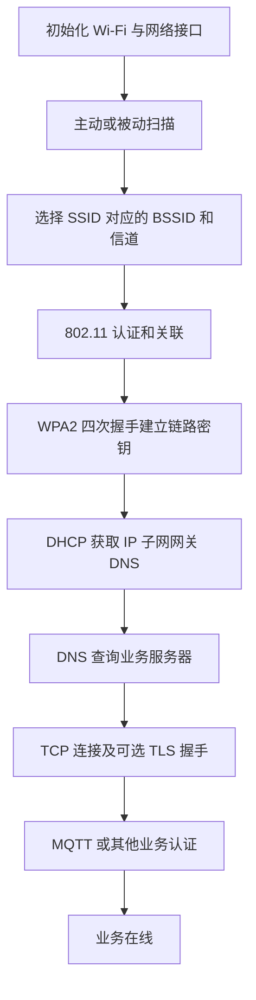

# Day 5：Wi-Fi 与 TCP/UDP

[[04-Day4-FreeRTOS同步与中断|上一天]] · [[00-开始这里|总计划]] · [[06-Day6-BLE-MQTT与低功耗|下一天]]

## 今日任务（240 分钟）

- [ ] 90 分钟：理解 Wi-Fi、IP、TCP、业务连接的分层关系。
- [ ] 60 分钟：运行 TCP 流式解析实验，逐字节喂入报文。
- [ ] 50 分钟：设计重连状态机和命令幂等机制。
- [ ] 40 分钟：复习 Day 4，并完成本页自测。

## Q29 Wi-Fi 连接全过程

先确定身份：设备以 Station（STA）身份接入路由器/AP；扫描只是发现网络，不等于已经获得联网能力。

以下是 **WPA2-Personal + IPv4 DHCP** 的常见主线：



### 每一步发生了什么

1. **扫描**：被动扫描监听 AP 的 Beacon；主动扫描发送 Probe Request，接收 Probe Response。获得 SSID、BSSID、信道、安全方式、信号强度等。SSID 是网络名，BSSID 标识具体 AP 无线接口；同一 SSID 下可以有多个 AP。
2. **选择 AP**：综合已配置网络、信号强度、安全要求、历史连接与漫游策略，不能仅凭 RSSI 高低判断互联网是否可用。
3. **802.11 认证/关联**：建立 STA 与 AP 的链路关系，协商能力。在典型 WPA2-Personal 中，早期 Open System 认证并不等于已经验证 Wi-Fi 密码。
4. **WPA2 四次握手**：双方基于共享密钥材料及随机数等派生会话密钥、确认密钥持有并安装链路密钥；不是把明文密码发给 AP。WPA3-SAE 和企业 EAP 流程不同，不能逐步照搬。
5. **DHCP**：经典 DORA：Discover → Offer → Request → ACK。获得地址、掩码、网关、DNS、租期。静态 IP 可跳过 DHCP；IPv6 另有地址配置机制。
6. **业务联网**：用 DNS 得到服务器地址，再建立 TCP/TLS/MQTT 等连接。局域网连接成功不代表 DNS、互联网和业务服务器都正常。

ESP-IDF v5.2 中，通常将 Wi-Fi 连接事件与 `IP_EVENT_STA_GOT_IP` 分开处理；需要基于 IP 的 socket 业务，应等待地址就绪。断链事件发生后处理业务连接失效与重连，而不能只看一个 `wifi_connected` 布尔值。[ESP-IDF Wi-Fi 驱动指南](https://docs.espressif.com/projects/esp-idf/en/v5.2/esp32/api-guides/wifi.html)

### 分层定位故障

| 现象 | 优先检查 |
|---|---|
| 扫不到 SSID | 频段/信道支持、距离、天线、隐藏网络及扫描配置 |
| 反复认证失败 | 凭据、安全模式、AP 配置；不要无休止快速重试 |
| 已关联但没有 IP | DHCP 服务、地址池、网络接口启动时序 |
| 有 IP 但不能访问域名 | DNS、网关、网络连通性 |
| TCP 成功但 TLS 失败 | 证书链、主机名、设备时间、内存和协议配置 |
| MQTT 被拒绝 | Broker 凭据、客户端 ID、权限与服务端策略 |

## Q30 断连与重连状态机

不要在事件回调里写 `while (connect_failed) reconnect();`。让网络管理任务负责状态和定时重试，事件回调只报告状态变化。

```text
STOPPED → CONNECTING_WIFI → WAIT_IP → CONNECTING_SERVICE → ONLINE
                  任何阶段失败 → BACKOFF → 对应的连接阶段
凭据错误/配置无效 → NEED_CONFIG（等待用户配置或低频检查）
```

### 一套可落地的规则

1. **区分失败类型**：AP 消失、认证失败、DHCP 超时、DNS 失败、服务器不可达分别记录；业务服务短暂失败不必每次重置整套 Wi-Fi。
2. **单一重连入口**：同一时刻只允许一个连接尝试/重试定时器，避免多个事件触发并发重连。
3. **指数退避加抖动**：例如 `cap=min(60s,1s*2^n)`，实际等待在 `[0.5*cap, cap]` 内随机选择；n 有上限。这样既限制功耗，也避免设备集群同时冲击 AP/服务器。
4. **稳定后才清零**：连续在线 30～60 秒再重置退避计数，避免“连上 1 秒→掉线→从 1 秒开始”的反复抖动。此数值是示例设计参数，需按业务调整。
5. **超时与失败预算**：每阶段有截止时间，每轮尝试有上限；电池设备连续失败后可进入更长休眠，等待下一轮。
6. **弱信号迟滞**：不要只凭一次 RSSI 低就主动断开。使用平滑值、持续时间及不同断开/恢复阈值；先判断实际丢包/业务健康。
7. **缓存有边界**：离线队列设条目数、大小和有效期上限；明确丢旧遥测、保留告警或压缩聚合策略。
8. **旧连接事件隔离**：给连接尝试加 generation/epoch，忽略旧连接迟到的回调，避免新连接被旧失败事件误关闭。

退避伪代码：

```text
on_failure(reason, connection_generation):
    if generation 已过期: return
    清理这一轮连接资源
    if reason 是凭据错误: 转 NEED_CONFIG
    else:
        cap = 先限制指数再计算，最大 60 秒
        delay = random(cap/2, cap)
        安排唯一重试定时器
        转 BACKOFF
```

这不是“弱网永不掉线”，而是在失败不可避免时控制重试频率、资源和功耗。观察指标包括各阶段耗时、失败原因分布、连续重试次数、离线数据丢弃量和电流曲线。

## Q31 TCP 与 UDP 怎么选

| 项目 | TCP | UDP |
|---|---|---|
| 数据模型 | 有序字节流，不保留应用消息边界 | 数据报，有报文边界 |
| 协议保障 | 序号、确认、重传、流量控制和拥塞控制 | 不保证到达、顺序或去重 |
| 丢包效果 | 后续字节通常等待缺口修复，产生队头等待 | 其他报文可继续交付，应用决定如何处理丢失 |
| 常见用途 | MQTT、HTTPS OTA、可靠命令通道 | 局域网发现、部分实时遥测、CoAP 类应用 |
| 代价 | 状态和缓冲开销，重连/握手成本 | 若业务要求可靠性，需要应用自行补机制 |

TCP 的可靠性是连接内的传输语义，不保证对端业务已经执行；UDP 也不天然“延迟一定更低”或“功耗一定更省”。若自己补完复杂可靠传输，可能比 TCP 更难维护。[TCP 标准 RFC 9293](https://www.rfc-editor.org/rfc/rfc9293.html)

### TCP 下还需要应用确认吗

例如设备发送“阀门设为关闭”，服务器 TCP 栈确认收到，并不表示业务数据库已提交/阀门已完成动作。发送成功也可能只是数据进入本机发送缓冲。

需要重要命令结果时，增加：`request_id + 命令参数 + 业务 ACK/结果 + 截止时间`。超时重试沿用同一个 request_id；接收端保存已执行结果，重复请求只重发结果，避免重复副作用。

幂等指重复执行产生相同最终效果。`设置开关=关` 通常比 `切换开关状态` 更容易幂等。`扣一次库存`、`电机转一圈` 不能仅靠重试做到安全；需要幂等键和持久状态设计。

TCP 负责包级重传，应用不要因每次短暂 ACK 等待就重复发送相同业务命令；先定义业务超时，防止与传输层重传叠加形成请求风暴。

### UDP 的有界可靠方案

包头至少包含协议版本、设备/会话标识、消息序号、载荷长度。可靠命令还需要 ACK、超时、有限重试和去重窗口。

- 超时根据测量 RTT 与抖动设置；重试采用退避，不无限狂发。
- 接收端重复包可再次回 ACK，但不再次执行业务；乱序数据按序号/时间戳处理。
- 过期遥测可丢弃，不能让旧温度阻塞新数据。
- 控制数据报大小以避免 IP 分片；“固定多少字节永不分片”取决于路径 MTU，不能对所有网络保证。
- 校验能发现误码不代表能防伪造；有安全需求时用标准安全传输，如合适的 DTLS/上层安全协议。

## Q32 TCP 拆包与组包

所谓“粘包”是应用误以为 TCP 会保留每次 send 的边界。发送两次 ABC 和 DEF，接收端可以一次读到 ABCDEF，也可以多次读到 A、BCDE、F；字节顺序正确，TCP 就没有违反契约。

发送端还要处理 `send` 的部分写入；接收端 `recv` 返回 0 通常表示对端有序关闭，负值根据错误码区分重试、超时或故障。

### 三种常见分帧方式

| 方法 | 优点 | 注意点 |
|---|---|---|
| 固定长度 | 简单 | 浪费空间，不适合高度变长消息 |
| 分隔符，如换行 | 易调试 | 二进制载荷需转义；限制最大行长 |
| 长度头 + 载荷 | 通用、适合二进制 | 先验证长度，防超大分配、溢出和半包 |

本练习定义 **2 字节大端长度 + N 字节载荷**，N 最大 64，可为 0。先收满 2 字节头，再收满 N 字节；一条完成后立即继续处理剩余输入。

```text
00 03 41 42 43  00 02 44 45
└长度3┘ A  B  C └长度2┘ D  E

可能的 recv 边界：
[00] [03 41] [42 43 00 02 44 45]
```

### 解析器必须满足的条件

1. 数据不够时保留解析状态，等待下次，不把“还没收齐”当成格式错误。
2. 一次输入有多帧时循环处理，不能只解析第一帧。
3. 读取头后先检查最大长度，再复制/分配；不相信网络输入。
4. 断线后清空此连接的半包状态，不能拼到新连接的数据前。
5. 半包需要超时和缓冲上限，防止发送头后永久不发正文占资源。
6. 本练习无魔数；遇到非法长度后关闭/重置连接，不从任意字节猜边界。若设计魔数重同步，也需长度、版本和完整性检查，不能盲目扫魔数。

代码 `实验代码/05_stream_parser.c` 使用固定缓冲、显式状态，涵盖逐字节接收、多帧合并、零长度、最大长度、非法长度和半包后重置。回调只在帧完整时执行，payload 指针只在回调期间有效；异步使用必须复制或转移独立缓冲所有权。

```bash
gcc -std=c11 -Wall -Wextra -Wpedantic -O2 实验代码/05_stream_parser.c -o /tmp/embedded_stream
/tmp/embedded_stream
```

练习解析器没有 socket、TLS 或超时计时器；把它接入实际客户端时，需要调用者实现连接管理和半包截止时间。它验证的是**流式分帧算法**，不是整个网络协议栈。

## 自测与答案

1. 已收到 Wi-Fi 关联事件，为什么仍不能假定 socket 可用？
2. AP 密码错了，应每 100ms 重连吗？
3. TCP 的 ACK 能否证明应用执行了命令？
4. TCP_NODELAY 能否解决分帧问题？
5. 收到长度 65535 时，应先 malloc 再尝试接收吗？
6. UDP ACK 丢了，接收端又收到相同序号命令，应怎么办？

> [!answer]- 答案
> 1. 可能还没获得有效 IP，更别说 DNS/TCP/业务认证。2. 不应，应区分配置错误并进入配置处理或低频重试。3. 不能，它是传输层确认。4. 不能，它改变 Nagle 等发送行为，不创造应用消息边界。5. 不应，先按协议上限校验并拒绝非法长度。6. 重发已记录的结果/ACK，避免再次执行。

## 今日过关标准

- [ ] 能分层解释“连上 Wi-Fi”和“业务在线”的区别。
- [ ] 重连设计包含退避、超时、单入口和稳定期。
- [ ] 能处理任意接收分片，而不是依赖一次 recv 收到完整包。
- [ ] 重要业务能说明超时重试如何避免重复执行。
