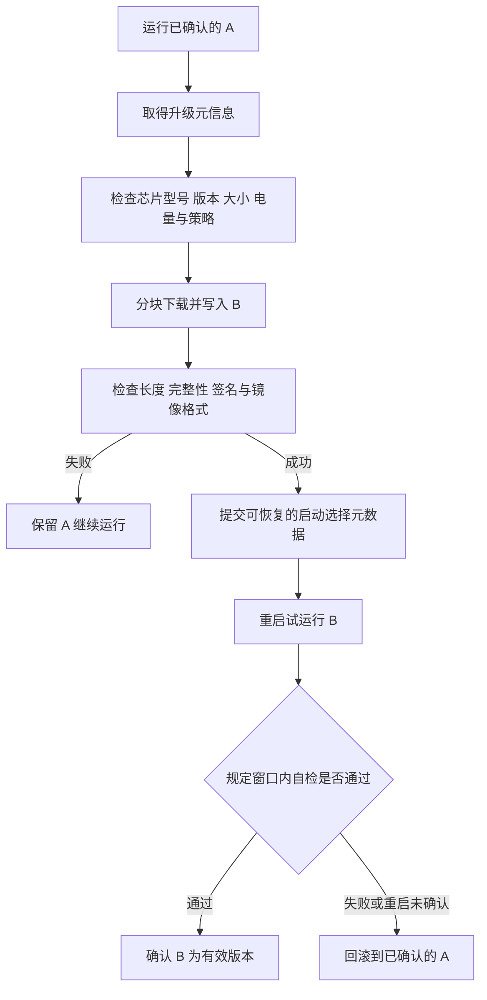
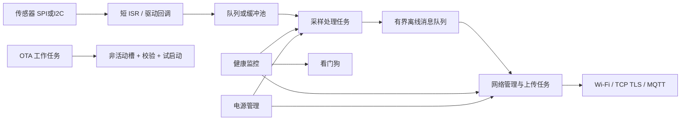

# Day 7：OTA、安全与看门狗

[[06-Day6-BLE-MQTT与低功耗|上一天]] · [[00-开始这里|总计划]] · [[08-模拟面试与速查|模拟面试]]

## 今日任务（240 分钟）

- [ ] 80 分钟：理解 OTA、分区、回滚、安全和看门狗。
- [ ] 60 分钟：逐项推演断电/故障矩阵。
- [ ] 40 分钟：把前六天内容串成一个无线传感器方案。
- [ ] 60 分钟：按 [[08-模拟面试与速查]] 完成闭卷面试与纠错。

## Q38 OTA 的完整过程

OTA（Over-The-Air）通过无线链路接收固件。传输可以走 Wi-Fi/HTTPS，也可以 BLE 分块传输；**下载链路与安全启动/分区切换是不同层次**。

最常见可靠方案是 A/B 应用槽：当前运行 A，新固件写 B；校验完整并验证可信后才请求下一次启动 B。



### 每个阶段必须做的事

1. **升级元信息**：设备型号、硬件修订、固件版本、镜像长度、摘要、签名/可信来源、最低兼容版本。摘要若与镜像来自同一未认证来源，不能单独证明真实性。
2. **前置检查**：槽位容量足够，电量/供电符合升级策略，目标芯片匹配，当前版本已经确认；避免在待验证状态中反复升级。
3. **分块写入**：使用小而有界的接收缓冲，不必把完整固件放 RAM。按 Flash 擦除/写入粒度和 SDK API 操作，跟踪偏移及错误返回。
4. **完成校验**：长度、镜像结构、可信摘要/签名及安全版本要求通过后，才提交启动槽选择。
5. **试启动与确认**：新版本验证关键任务、存储兼容性、重要外设和必要的业务功能；通过后显式确认。
6. **失败恢复**：旧版本及其必要配置仍可运行；记录失败原因，避免无限下载同一坏版本。

ESP-IDF v5.2 的常见 API 路径是选择非运行槽 → `esp_ota_begin` → 多次 `esp_ota_write` → `esp_ota_end` → 成功后 `esp_ota_set_boot_partition` → 重启。具体校验能力取决于安全配置，不能假设 `esp_ota_end` 在未启用相关机制时自动完成所有签名要求。[ESP-IDF v5.2 OTA 文档](https://docs.espressif.com/projects/esp-idf/en/v5.2/esp32/api-reference/system/ota.html)

### 断电时为什么通常能恢复

关键原则是：**在新版本可启动并确认之前，不破坏当前已确认的镜像和恢复所需数据；启动元数据采用可检测损坏、可恢复的提交机制。**

ESP-IDF 的 otadata 使用两个 Flash 扇区，并借助序号/校验等选择有效记录，不能用一个可能写到一半的裸 `active_slot` 变量替代。[ESP-IDF OTA data 机制](https://docs.espressif.com/projects/esp-idf/en/v5.2/esp32/api-reference/system/ota.html#ota-data-partition)

“永远不变砖”无法仅靠双分区保证。Bootloader 被破坏、两个槽同时坏、分区表改坏、供电超出 Flash 规格、错误烧写安全配置，都可能破坏恢复路径。普通应用 OTA 应尽量不触碰 Bootloader/分区表；需要升级它们时另行设计专用容错机制，并保留受控的有线救援方式。

## Q39 分区表与回滚

### 4MiB Flash 的教学分区示例

前提：经典 ESP32，分区表按默认位于 0x8000；应用起始地址遵守 64KiB 对齐；示例不含 factory 槽，两个应用槽各 1.5MiB。其他芯片及安全配置可能要求调整 Bootloader 保留区，不能直接烧写到未知硬件。

```csv
# Name,   Type, SubType, Offset,   Size,     Flags
nvs,      data, nvs,     0x9000,   0x4000,
otadata,  data, ota,     0xD000,   0x2000,
phy_init, data, phy,     0xF000,   0x1000,
ota_0,    app,  ota_0,   0x10000,  0x180000,
ota_1,    app,  ota_1,   0x190000, 0x180000,
storage,  data, spiffs,  0x310000, 0xF0000,
```

| 区域 | 范围（结束地址不含） | 用途 |
|---|---|---|
| Bootloader 等保留区 | 分区表之前，实际由目标配置决定 | 启动与相关数据，不在上表当作普通 app 槽 |
| 分区表 | 0x8000～0x9000 | 描述后续分区 |
| nvs | 0x9000～0xD000 | 配置、键值数据 |
| otadata | 0xD000～0xF000 | 启动选择与 OTA 状态 |
| phy_init | 0xF000～0x10000 | 预留 PHY 初始化数据区域，使用方式依配置 |
| ota_0 | 0x10000～0x190000 | A 槽 |
| ota_1 | 0x190000～0x310000 | B 槽 |
| storage | 0x310000～0x400000 | 示例文件存储区域 |

末地址 0x400000 恰为 4MiB，应用槽均满足 0x10000 对齐。要给固件增长、签名和对齐开销留空间，不能只比较未签名 ELF 或代码段大小。正式工程用 `idf.py partition-table` 检查生成结果及镜像大小。[ESP-IDF 分区表规则](https://docs.espressif.com/projects/esp-idf/en/v5.2/esp32/api-guides/partition-tables.html)

没有 factory 槽并不等于不能初次启动：ESP-IDF 在相应初始状态下可从 OTA 槽启动；第一次完整烧录需要把固件放到正确槽地址。factory 也不是所有防回退配置都兼容，不能随意加入。

### 试启动状态机

在 **ESP-IDF v5.2** 中，需要按项目开启 `CONFIG_BOOTLOADER_APP_ROLLBACK_ENABLE`。后续版本配置名称和默认值可能变化，不靠记忆断言默认开启。

```text
新镜像完成 → NEW
首次引导 → PENDING_VERIFY
自检通过并调用 esp_ota_mark_app_valid_cancel_rollback() → VALID
自检失败并调用 esp_ota_mark_app_invalid_rollback_and_reboot() → INVALID，尝试回滚
待验证期间复位，未确认 → 后续引导按回滚状态机处理，候选可变为 ABORTED
```

回滚前提是存在仍可启动、符合安全版本策略的旧镜像。**应用挂住但不复位，Bootloader 没机会执行回滚**，因此看门狗或其他复位机制是试启动保障的一部分。[ESP-IDF v5.2 回滚状态](https://docs.espressif.com/projects/esp-idf/en/v5.2/esp32/api-reference/system/ota.html#app-rollback)

确认时机不能太早：“进入 app_main 就确认”无法发现业务故障。也不能把短暂互联网中断一概当成坏固件：根据产品定义可在本地自检、外设通信、配置验证后加入有界的网络/升级服务器检查，分清外部网络故障与软件无法工作。确认窗口、恢复条件和重试政策必须明确。

### 常被遗漏的配置回滚

B 启动后把 NVS schema 从 v1 迁移到 v2，随后 B 崩溃并回滚到 A；如果 A 无法读 v2，即使镜像回滚成功设备也可能不能工作。

解决办法包括：新版本兼容旧格式、迁移时写到新区域而保留旧副本、双份配置加版本、确认成功后再提交不可逆变更。回滚设计覆盖**镜像 + 配置 + 安全策略**，不只是两个 `.bin` 文件。

## Q40 签名、加密与防回退

| 机制 | 解决什么问题 | 不能代替什么 |
|---|---|---|
| CRC/普通校验和 | 发现一定范围的传输/存储差错 | 不能证明发行者身份 |
| 加密哈希，如 SHA-256 | 给出内容摘要；结合可信预期摘要验证完整性 | 攻击者可同时替换镜像和未认证摘要 |
| 数字签名 | 验证镜像由可信私钥授权且未被篡改 | 不隐藏镜像内容 |
| HTTPS/TLS | 保护传输机密性/完整性，并按配置认证服务器 | 不自动构成设备启动时的镜像信任链 |
| Secure Boot | 沿信任链验证将执行的启动代码/应用 | 不等于 Flash 内容保密 |
| Flash Encryption | 降低离线读取外部 Flash 明文的风险 | 不自动证明固件来源可信 |
| 防回退 Anti-rollback | 拒绝低于安全版本下限的已知脆弱镜像 | 不等于所有旧业务版本都禁止恢复 |

签名由发布侧私钥生成，设备持有验证公钥/其可信摘要。私钥不应放进量产固件。仅有“固件加密”但没有可信认证，不能保证设备执行的是授权程序；只用 HTTPS 下载也不能替代启动时的信任验证。

ESP-IDF 可组合安全启动、Flash 加密与安全 OTA；具体算法、支持芯片修订、密钥生命周期和配置要匹配目标。设备端 Flash 加密也不一定意味着服务器必须托管同样形式的密文镜像。[Espressif 安全机制概览](https://docs.espressif.com/projects/esp-idf/en/stable/esp32/security/security.html)

### 安全防回退与可靠性回滚如何共存

应用版本可从 2.4 回到 2.3；安全版本下限表示“禁止回到某类已知漏洞版本”。如果过早把不可逆安全计数提高到旧槽不满足的值，就会自己切断回滚路径。

因此必须在受支持的确认流程与发布策略中协调安全版本提升，验证旧槽是否仍满足下限。安全计数/eFuse 操作可能不可逆，次数/位数受芯片限制，不能把它当普通 RAM 版本号。本文只讲设计，不提供烧写 eFuse 的实验步骤。

## Q41 看门狗应该谁来喂

看门狗由独立或相对独立的计时机制监视系统是否在期限内完成喂狗；超时后触发中断、诊断或复位，依硬件/配置决定。它是故障恢复手段，不是用来掩盖死锁和时序问题。

### 为什么放在固定任务里无条件喂可能无效

如果高优先级 FeedTask 每秒喂一次，而采样任务已经死锁，FeedTask 仍然健康，系统就永不复位。若把喂狗放在独立定时中断里，主线程全挂了也可能一直被喂。

正确目标是检查**关键业务是否继续前进**，不是“某个任务是否还抢得到 CPU”。

### 方案 A：各任务由任务看门狗分别监控

平台支持时，每个关键任务订阅任务看门狗，并在完成有意义的工作/合法状态转换后报告。ESP-IDF 区分中断看门狗 IWDT 与任务看门狗 TWDT：前者关注中断长期无法得到服务等问题，后者可监控任务/用户的进展或长期不让出 CPU 等情况，具体取决于订阅和配置。[ESP-IDF v5.2 看门狗说明](https://docs.espressif.com/projects/esp-idf/en/v5.2/esp32/api-reference/system/wdts.html)

### 方案 B：健康监控任务统一喂硬件狗

各业务任务维护完成计数、最近进展时间和当前状态，监控任务核对各自截止时间后才喂狗。

```text
采样任务：采样成功/明确处理了一次失败 → 更新进展
网络任务：成功收发，或按计划完成一次有界重试/进入退避 → 更新进展
存储任务：完成一次写入或报告可处理错误 → 更新进展

监控任务定期执行：
    对所有“此状态下应该有进展”的关键任务：
        检查进展时间没有超过该状态的期限
    检查共享资源错误和系统故障标志
    全部通过才喂硬件狗
    否则保存少量诊断（若安全可行），允许复位
```

进展数据本身要通过正确同步读取；tick 回绕要使用合适的无符号差值比较和受限时间区间，不能简单认为时间戳永远递增不回绕。

网络断开不等于任务死锁。设备在“等待下次退避重试”状态下可以完全健康；不要要求网络任务每秒必须成功发一次包才算活着。反过来，死循环里不断更新 heartbeat 也不能代表业务前进。

### 超时该设多长

根据合法最坏执行/等待时间、调度延迟和硬件时钟误差留余量。示例：正常最坏检查窗口 500ms，监控周期 100ms，可先评估 2s 看门狗，但这个数不是通用标准。OTA 擦写、TLS 握手、低功耗进入/退出可能改变窗口，需要专门验证；不能为通过测试就无限延长超时。

调试器可能暂停或影响看门狗；量产无调试器、低电量、弱网和连续复位场景都要测。复位后读取并记录原因、连续失败次数；连续启动失败可进入恢复模式，避免重启风暴。

## 故障注入矩阵

以下先做纸面推演；上板测试只在有备份和可恢复开发设备上进行，并遵循供电/Flash 规格。

| 故障注入点 | 预期结果 | 需要检查的证据 |
|---|---|---|
| 擦除/写 B 中途断电 | A 仍可启动 | 运行槽、旧镜像完好、B 不被误当有效 |
| 下载完整但尚未提交启动选择时复位 | 继续 A，或按明确恢复流程处理候选 | 元数据与镜像状态一致 |
| 启动选择记录写入时断电 | 至少一份有效元数据可用，选择合法镜像 | 两份记录的序号/校验及实际启动结果 |
| B 首启未确认就崩溃 | 复位后按回滚流程恢复 A | 回滚状态、复位原因、有效旧槽 |
| B 首启死循环 | 看门狗触发复位，再回滚 | 狗没有被无条件喂养掩盖故障 |
| 签名错误/目标芯片不符 | 拒绝激活镜像 | 失败返回码，启动选择未错误提交 |
| B 迁移配置后故障 | A 仍能读取可用配置 | schema 版本、备份与迁移事务 |
| A 的安全版本低于防回退下限 | 不假定可回滚 A，进入预先设计恢复路径 | 发布策略没有破坏恢复约束 |
| 连续升级同一坏版本 | 有失败计数/版本隔离/退避 | 不无限升级重启耗尽电池 |

## 七天综合方案：无线传感器



用 3 分钟讲清以下关系：采样缓冲如何分配和归还；回调在哪个上下文；任务优先级与阻塞点；弱网时如何控制重试和积压；报文如何分帧和去重；睡眠保存什么；OTA 如何避免破坏旧系统；看门狗如何知道业务真的有进展。

## 自测与答案

1. 写 B 到一半，为什么 A/B 方案仍可能安全启动？
2. B 自检未确认但一直死循环，Bootloader 会主动跑出来回滚吗？
3. SHA-256 与镜像一起从不可信来源拿到，能否证明镜像可信？
4. 已签名的旧镜像是否一定允许回滚？
5. 镜像回滚成功，为什么配置仍可能导致设备不能工作？
6. 看门狗专用任务一直运行是否代表系统正常？

> [!answer]- 答案
> 1. 当前已确认 A 未被覆盖，候选未完成前不提交激活。2. 不会，必须有复位/恢复触发机制，看门狗是常见保障。3. 不能，攻击者能同时替换两者。4. 不一定，还受安全版本下限、镜像状态等限制。5. 新版本可能做了旧版本不理解的不可逆 schema 迁移。6. 不代表，它必须依据关键任务的有意义进展决定是否喂狗。

## 今日过关标准

- [ ] 能给出分区地址与大小，并检查容量和对齐。
- [ ] 能逐项推演断电，说明最后一个可信恢复点。
- [ ] 能区别完整性、真实性、保密性和防回退。
- [ ] 看门狗方案能检测业务死锁，也不会把合法离线退避误判成死锁。
